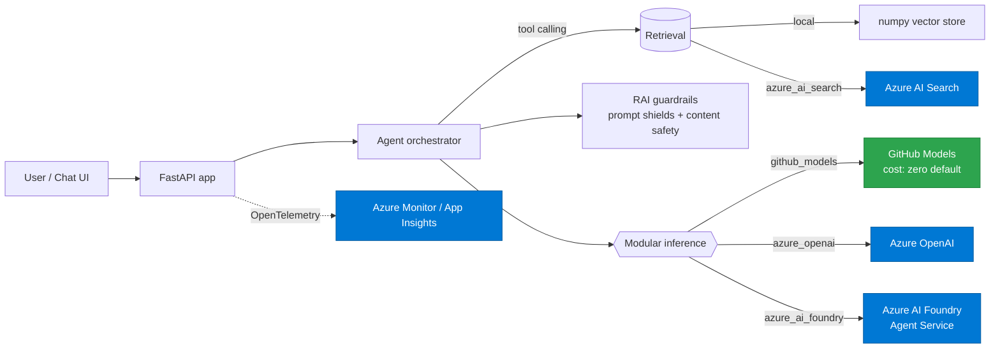

<!-- markdownlint-disable MD033 MD041 -->
<div align="center">

# 🎓 MicroHack — AI Platform on Microsoft Azure (Module B)

### A 1-day, classroom-led, **Train-the-Trainer** hands-on lab

**Assessment → Design → PoC → Deployment → Validation → Hand-over**, on Azure —
producing audit-ready evidence for all **7 Module B controls** while you learn the
latest **GitHub Copilot agents · skills · MCP servers · GitHub Models · Azure AI
Foundry Agent Service · Microsoft Agent Framework**.

[](https://github.com/NikoMix/specialization-ai-platform)
[](https://github.com/NikoMix/specialization-ai-platform)
[](#-modular-inference)
[](#-quickstart-zero-cost-path)
[](LICENSE)

</div>

---

## 📌 What this is

This repository is a **complete, re-deliverable training kit**. It is built as
*Train-the-Trainer*: a trainer can run the full day from the [Trainer Guide](docs/),
and pupils work through eight hands-on labs that build a real **agentic RAG assistant**
("**Contoso AI Assistant**") and, as a by-product, generate the **exact evidence
artefacts** a partner needs for the *AI Platform on Microsoft Azure Specialization*
(Module B) audit.

> The training is **Azure-first** but every lab also runs at **zero cost on GitHub
> Models**, so a full classroom can complete the day without an Azure subscription —
> then *migrate to Azure* in Lab 5 by changing configuration only.

## 👥 Who it is for

| Audience | What they get |
|---|---|
| **Trainers** (primary) | A turn-key day: facilitation notes, timings, talk tracks, demo scripts, and answers — see [`docs/trainer-guide`](docs/). |
| **Pupils / consultants** | Hands-on labs that build the solution and the audit evidence. |
| **Partner practice leads** | A repeatable engagement pattern aligned to the V1.8.1 audit. |

## 🗺️ The day at a glance — labs ↔ Module B controls

The microhack mirrors the AI delivery lifecycle. Each lab produces a real artefact mapped to a control.

| Lab | Title | Module B control | Evidence produced | Latest feature spotlight |
|----:|-------|------------------|-------------------|--------------------------|
| **0** | Setup: Copilot, MCP & GitHub Models | *(enabler)* | Working dev environment | MCP servers, GitHub Models |
| **1** | Assess the opportunity with Copilot agents | **B.1.1** | Portfolio assessment + AI-Powered Apps deep-dive | Copilot custom agents + skills |
| **2** | Design + Responsible AI | **B.2.1** | HLD/LLD + RAI Standard V2 ack + Impact Assessment | Practice specialty B (AI Foundry SDK) |
| **3** | Azure Well-Architected AI review | **B.2.2** | WAF AI-workload assessment (2 pillars × workload) | WAF AI workload assessment |
| **4** | Build the agentic RAG PoC | **B.2.3** | PoC doc + **Azure AI Foundry** results | Agent Service + Microsoft Agent Framework |
| **5** | Deploy to Azure with IaC | **B.3.1** | Bicep deploy incl. **Azure AI Foundry**; as-built | AVM-first Bicep, managed identity |
| **6** | Validate, test & evaluate | **B.4.1** | Eval report + post-deployment WAR (Op Excellence) + sign-off | Azure AI Evaluation, eval-driven dev |
| **7** | Operate & hand over | **B.4.2** | As-built + **SOPs/runbook** + acceptance | Copilot-generated runbooks |
| **✚** | Migration accelerator | *cross-cutting* | Provider swap → Azure AI Foundry | Modular inference, zero code change |

Full requirement-by-requirement coverage is in **[`docs/` → Module B mapping](docs/)**.

## ✨ Latest capabilities you will use

- **GitHub Copilot custom agents** (`.github/agents/*.agent.md`) — an *Engagement Architect*,
  *RAI Reviewer*, and *Lab Coach* that drive the assessment, design, and validation labs.
- **Copilot skills / skillsets** (`.github/skills/`) — reusable, parameterised capabilities.
- **MCP servers** — Azure MCP, GitHub MCP, Microsoft Learn MCP, **plus a custom MCP server**
  in this repo (`src/aiplatform/mcp_server/`) that exposes the assistant's tools.
- **GitHub Models** — free, OpenAI-compatible inference for the no-cost path.
- **Azure AI Foundry Agent Service** + **Microsoft Agent Framework** — the production agent runtime.
- **Modular inference** — one app, three providers, swap by config.

## 🧱 Architecture



## 🔌 Modular inference

`INFERENCE_PROVIDER` selects the backend. Application, agent, RAG, eval, and guardrail code
depend **only** on the `aiplatform.inference.base` contract — never on a concrete SDK — so the
**migration lab** is a one-line configuration change, not a rewrite.

```text
github_models      → GitHub Models     (OpenAI-compatible, free, no Azure)
azure_openai       → Azure OpenAI      (Entra ID / key-less)
azure_ai_foundry   → Azure AI Foundry  (Agent Service, DefaultAzureCredential)
```

## 🚀 Quickstart (zero-cost path)

Prerequisites: **Python 3.11–3.13**, [`uv`](https://docs.astral.sh/uv/), and a GitHub
fine-grained PAT with **Models** read access.

```bash
git clone https://github.com/NikoMix/microhack-ai-platform.git
cd microhack-ai-platform

cp .env.example .env          # then set GITHUB_TOKEN=<your PAT>
uv sync --extra dev           # creates a Python 3.12 venv and installs deps

uv run aiplatform chat "What is the Contoso returns policy?"   # CLI smoke test
uv run uvicorn aiplatform.app.main:app --reload                # web UI at http://localhost:8000
```

### Azure path (Labs 5–7)

```bash
uv sync --extra azure --extra eval --extra safety --extra telemetry
az login
azd up        # or: az deployment sub create -f infra/main.bicep
```

## 📚 Run the training site locally

```bash
cd docs
npm ci
npm run dev          # Starlight site with the full Trainer Guide + 8 labs
```

The site also deploys automatically to **GitHub Pages** on push to `main`.

## 🗂️ Repository layout

```text
microhack-ai-platform/
├── .github/
│   ├── agents/            # Copilot custom agents (.agent.md)
│   ├── skills/            # Copilot skillsets
│   ├── workflows/         # CI: lint, type, test, security, build, deploy
│   └── copilot-instructions.md
├── docs/                  # Astro/Starlight training site (Trainer Guide + Labs)
├── infra/                 # Bicep (AVM-first) IaC for the Azure deployment lab
├── labs/assets/           # Evidence templates (assessment, design, RAI, SOP, runbook, WAR)
├── mcp/                   # MCP server configuration for Copilot/clients
├── src/aiplatform/
│   ├── inference/         # Modular inference contract + providers
│   ├── agents/            # Agent orchestration (Foundry + local + Agent Framework)
│   ├── rag/               # Retrieval (local numpy + Azure AI Search)
│   ├── eval/              # Evaluation harness (B.4.1)
│   ├── guardrails/        # Responsible AI guardrails
│   ├── mcp_server/        # Custom MCP server exposing the assistant tools
│   ├── app/               # FastAPI API + minimal chat UI
│   └── telemetry/         # OpenTelemetry / Azure Monitor wiring
└── tests/                 # Unit + integration tests
```

## 🤝 Contributing & license

Contributions welcome — see [`CONTRIBUTING.md`](CONTRIBUTING.md) and the conventions in
[`.github/copilot-instructions.md`](.github/copilot-instructions.md). Licensed under
[MIT](LICENSE). Uses only OSI-licensed dependencies.

> Built to complement the [AI Platform on Microsoft Azure Specialization toolkit](https://github.com/NikoMix/specialization-ai-platform).